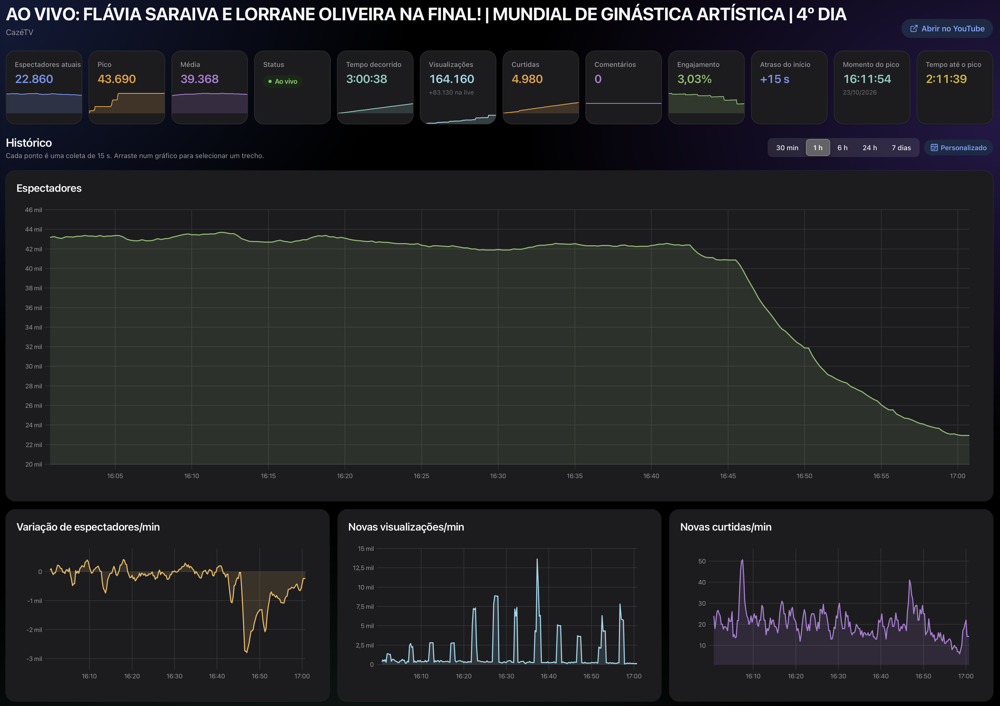

# youtube-live-monitor

Monitor for public YouTube live streams. Register lives by URL or ID and follow audience, views, likes, comments and engagement, with a 15-second history.

It only uses the YouTube Data API v3 (`videos.list`): it does not read chat, download video or access anything private. The interface is available in Portuguese, English and Spanish, with light and dark themes.



## Stack

| Layer | Technology |
|---|---|
| Collector and API | Python 3.12, FastAPI, uvicorn |
| State and settings | SQLite (API key encrypted with Fernet, password hashed with argon2) |
| Time series | VictoriaMetrics |
| Interface | React 19, TypeScript, Vite, uPlot |
| Deployment | Docker Compose |

## Requirements

- Docker with the Compose plugin (Linux or macOS, amd64 or arm64)
- A YouTube Data API v3 key

## Installation

```bash
git clone https://github.com/arraisfilho/youtube-live-monitor.git
cd youtube-live-monitor
./install.sh
```

The installer generates the application secret in `secrets/`, starts the containers and prints a temporary password, which must be changed on first sign-in. The interface is served at http://127.0.0.1:8082.

## Usage

1. Sign in and set your password.
2. In **Settings**, add your YouTube Data API key.
3. In **Lives**, register streams by URL or ID.

Each live has indicators, charts and an optional public link (`/p/<token>`) that shows only that live's metrics. The **Collector health** page shows quota usage and polling state. The language can be switched at any time from the globe icon.

```bash
docker compose exec app python -m backend.serve reset-password   # new temporary password
docker compose logs -f app
./uninstall.sh            # removes the containers and keeps the data
./uninstall.sh --purge    # removes everything
```

## Configuration

The API key, daily quota, polling interval and display time zone are set in the Settings page. Optional variables:

| Variable | Default | Effect |
|---|---|---|
| `YLM_BIND` | `127.0.0.1:8082` | published address |
| `YLM_RETENTION` | `12` | history retention, in months |

For external access, put `YLM_BIND` behind a reverse proxy with HTTPS that sends `X-Forwarded-Proto`.

## Development

```bash
python3 -m venv .venv && . .venv/bin/activate
pip install -r requirements.txt -r requirements-dev.txt
make check
```

See [CONTRIBUTING.md](CONTRIBUTING.md) and [SECURITY.md](SECURITY.md).

## License

MIT. See [LICENSE](LICENSE).
